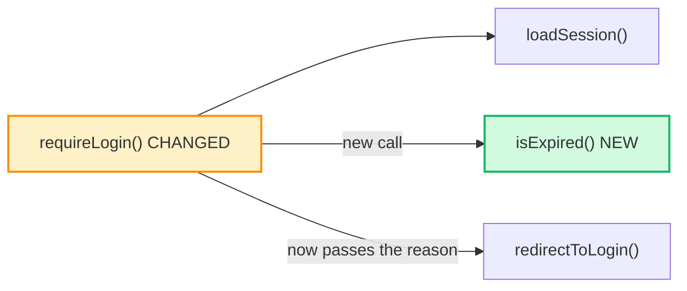

# Explaining Diffs

## Overview

Explain a finished diff so the person verifying it can understand it, and explain it to someone else, without reading the raw diff or hearing how the work was done. The explainer describes the end state only: what changed, where, why, how the pieces connect, and what evidence says it works. It is written for a junior engineer or a non-technical reader, and it comes as two files with the same content: a Markdown note with Mermaid diagrams, and a self-contained HTML page with inline SVG diagrams.

This is the long-form, human-facing counterpart of the short in-chat change summary in `git-workflow-and-versioning` (Change Summaries). That summary stays the default after any edit; this explainer is for the moment someone has to sign off on the change.

## When to Use

- A task is finished and you are about to ask the human to verify it
- A branch built without per-task review is about to become a pull request; link the explainer in the PR description
- Someone asks you to explain a diff, a commit, a range, or what changed on a branch

**When NOT to use:** judging whether the change is good (use `code-review-and-quality`), writing a commit message or PR title (use `git-workflow-and-versioning`), or documenting a long-lived decision (use `documentation-and-adrs`).

## Process

### Step 1: Pin the diff

Name the exact change you are explaining, so every line number in the explainer stays true.

| Situation | Range to explain |
|---|---|
| One finished task | That task's commit(s): `<first>^..<last>` |
| A whole branch before its PR | `$(git merge-base HEAD <base>)..HEAD`, one section per task |
| A requested commit, range, or PR | Exactly what was asked |
| No range given | The branch versus its base, plus any uncommitted changes |

```bash
git rev-parse --short HEAD                 # the commit you are pinned to
git status --porcelain                     # uncommitted or untracked changes?
git diff --stat <range>                    # the files involved
git diff -U0 <range>                       # every hunk, with exact line numbers
```

For uncommitted changes, diff against `HEAD`. Untracked files aren't in `git diff`, so read them directly. Write the pin at the top of the explainer: "Commit `a1b2c3d`" or "Uncommitted changes on top of `a1b2c3d`".

### Step 2: Find the requirement behind the change

Read the source of truth: the task's acceptance criteria, the spec section, the issue, or a task file in the repo. Every *why* you write in Step 4 must point to a specific sentence there. If no requirement exists, say so; don't invent a business reason.

### Step 3: Group hunks into changes by purpose

A *change* is one idea the reader needs to understand ("idle sessions now log out"), not one file. One change can span files, and one file can hold two changes.

List every hunk from `git diff -U0` and assign each to exactly one change. Supporting edits like imports, exports, renamed parameters or wiring belong to the change they enable. Their why is "lets `requireLogin` use the new `isExpired`", not a new reason. A hunk that fits no change is a finding: explain it or flag it, never drop it.

### Step 4: Write each change

For each change, in this order:

- **Title.** Plain words, the outcome, not the code ("Idle sessions log out after 30 minutes").
- **What.** One or two short sentences about what is different now.
- **Why.** The requirement it satisfies, quoted or paraphrased with its source ("Task 3: *sessions idle for 30 minutes must expire*").
- **Where.** `file:start-end` for each hunk, using new-file line numbers. For a pure deletion, use the old-file lines: `file (removed, was 12-18)`.
- **Diff snippet.** The change's hunks as a red/green diff: removed lines red with `-`, added lines green with `+`, one or two unchanged lines of context, and new-file line numbers in the gutter. Color is never the only marker; the `+` and `-` stay. For a hunk longer than about 15 lines, show the lines that carry the change and say where the rest is ("12 more lines at `file:40-51`"). In the Markdown note this is a ` ```diff ` block.

```
BAD:  Refactored the auth middleware and updated tests.
GOOD: src/auth/session.ts:42-58 — Sessions now end after 30 minutes with no
      activity. Before, a laptop left logged in stayed logged in forever
      (Task 3: "sessions idle for 30 minutes must expire").
```

### Step 5: Draw how the pieces connect, when it helps

Draw a diagram when the change spans more than one function or file, or alters a call path, a dependency, or a data flow. Skip it for a change inside one function. Show the changed parts in their unchanged context, and make new and changed nodes look different by **both** style and label, never by color alone. In Mermaid that means a `classDef` per kind of change; label text alone isn't enough. Add one caption line saying what to notice.

In a call or dependency diagram, an arrow means "calls" or "depends on", nothing else. Draw `A --> B` only if `A` itself calls `B`. Label each new call with `-- "new call" -->`, and each existing call whose inputs changed with what changed, such as `-- "now passes the idle time" -->`. If the order of steps matters too, say so in the caption, or draw a separate diagram whose caption says it shows the order of steps rather than who calls whom.

Mermaid, for the Markdown note. Quote every label, because parentheses and colons in unquoted labels break some renderers:

````markdown

*`requireLogin` now asks `isExpired` before letting a page load; an expired session goes to `redirectToLogin`.*
````

Draw the same nodes and arrows as inline SVG for the HTML page (see the skeleton in Step 7).

### Step 6: Say how it was checked, and what wasn't

List only checks that actually ran against this diff, in this session or in CI output you can see. Give each as `command → observed result`. If the repository's test command is quick and hasn't run against this exact diff, run it now and report it. Then list what was **not** checked.

```
How this was checked
- npm test → 14 passed, 0 failed (includes the 2 new expiry tests)
- npm run build → no errors
Not checked
- Two browser tabs sharing one session
- The login page's "you were logged out" message (no UI tests exist)
```

Never present an expectation as a result. "Changing 30 to 31 minutes would fail the expiry test" is a guess unless you ran it. Leave the agent's process out entirely: no "first I tried", no dead ends, no files you looked at.

### Step 7: Write it in plain language, as two files

**Plain language:**
- Short sentences. Lead each change with the outcome a user would notice.
- Define every technical term the first time it appears, inline: "a *function* (a named step the program can run)". Terms used more than twice also go in a short glossary at the end.
- No unexplained acronyms. Keep code names in `backticks` so the reader can find them, but don't rely on them to carry the meaning.

**Files:** name both `<YYYY-MM-DD>-<task-id-or-branch>` with `.md` and `.html` extensions. Save them where the user's or project's instructions say. With no instruction, save them to `tasks/explainers/`, and don't commit them unless asked. An explainer committed into the diff it explains makes the diff wrong.

The Markdown note:

```markdown
# <What this change does, in plain words>

<Pin: commit or "uncommitted changes on top of <sha>"> · <date> · [HTML version](<same-name>.html)

## In one paragraph
<What a user would notice, and why it was needed.>

## The changes
### 1. <Title>
**What:** … **Why:** … **Where:** `file:10-15`, `file:3`

```diff
 function requireLogin(req) {
   const session = loadSession(req);
+  if (isExpired(session)) return redirectToLogin(req, 'idle');
```

## How the pieces connect
<Mermaid diagram + caption>

## How this was checked
<command → result list> · **Not checked:** <list>

## Glossary
```

The HTML page has the same sections and content. It must be self-contained, with no external scripts, stylesheets, fonts or images, so it opens offline and anywhere:

```html
<!doctype html>
<html lang="en"><head><meta charset="utf-8">
<meta name="viewport" content="width=device-width, initial-scale=1">
<title>Idle sessions log out after 30 minutes</title>
<style>
  :root { --bg:#fff; --fg:#1d2939; --muted:#667085; --line:#98a2b3;
          --node:#f2f4f7; --new:#d1fadf; --changed:#fef0c7; --link:#175cd3;
          --add:#dcfae6; --del:#fee4e2; }
  @media (prefers-color-scheme: dark) {
    :root { --bg:#101828; --fg:#f2f4f7; --muted:#98a2b3; --line:#667085;
            --node:#1d2939; --new:#054f31; --changed:#7a2e0e; --link:#84caff;
            --add:#053321; --del:#55160c; } }
  body { background:var(--bg); color:var(--fg); font:16px/1.6 system-ui, sans-serif;
         max-width:760px; margin:0 auto; padding:24px 16px; }
  a { color:var(--link); } code { font-family:ui-monospace, monospace; }
  svg { width:100%; height:auto; } svg text { fill:var(--fg); font:13px system-ui; }
  .node rect { fill:var(--node); stroke:var(--line); }
  .node.new rect { fill:var(--new); } .node.changed rect { fill:var(--changed); }
  .edge { stroke:var(--line); stroke-width:1.5; }
  pre.diff { background:var(--node); border-radius:6px; padding:8px 0; overflow-x:auto; font-size:13px; }
  pre.diff span { display:block; padding:0 12px; white-space:pre; }
  pre.diff .add { background:var(--add); } pre.diff .del { background:var(--del); }
  pre.diff .ln { font-style:normal; display:inline-block; width:3ch; color:var(--muted); user-select:none; }
</style></head><body>
<h1>Idle sessions log out after 30 minutes</h1>
<!-- same sections as the Markdown note; each change carries its diff snippet -->
<pre class="diff"><code><span><i class="ln">41</i>  const session = loadSession(req);</span>
<span class="del"><i class="ln"></i>- return next();</span>
<span class="add"><i class="ln">42</i>+ if (isExpired(session)) return redirectToLogin(req, 'idle');</span>
<span class="add"><i class="ln">43</i>+ return next();</span></code></pre>
<svg viewBox="0 0 600 120" role="img" aria-labelledby="d1">
  <title id="d1">requireLogin() now calls isExpired() before letting a page load</title>
  <defs><marker id="arrow" viewBox="0 0 8 8" refX="8" refY="4" markerWidth="8"
    markerHeight="8" orient="auto"><path d="M0,0 L8,4 L0,8 z" fill="currentColor"/></marker></defs>
  <g class="node changed"><rect x="10" y="40" width="150" height="40" rx="6"/>
    <text x="85" y="65" text-anchor="middle">requireLogin() CHANGED</text></g>
  <line class="edge" x1="160" y1="60" x2="220" y2="60" marker-end="url(#arrow)"/>
  <g class="node new"><rect x="220" y="40" width="170" height="40" rx="6"/>
    <text x="305" y="65" text-anchor="middle">isExpired() NEW</text></g>
  <!-- … one <g class="node"> per node, one <line class="edge"> per arrow -->
</svg>
<p><em>Every page load now checks how long the session has been idle.</em></p>
</body></html>
```

If the environment can publish or render pages for the user, you may publish the HTML as well; the files are still the source. If you can't write files in this session, put the complete Markdown note in your reply, with the diagram, checks and glossary, and say that the files weren't saved.

### Step 8: Hand it over

In the verification request (or the PR description), give both file paths or the published link, a two-to-three-line summary of what changed and why, and the "not checked" list. The explainer supports the human's verification; it doesn't replace it.

## Common Rationalizations

| Rationalization | Reality |
|---|---|
| "The diff is small, the commit message is enough" | The commit message is for history. The verifier needs where, why, and what was checked, in words they can repeat. A small diff makes a short explainer, not none. |
| "Imports and exports are too trivial to mention" | Every hunk the reader sees and you skip makes them wonder what else was skipped. One clause attaches it to the change it enables. |
| "I know why this changed, I don't need to cite the task" | A why with no source is a guess the reader can't check. Quote the requirement, or say there isn't one. |
| "The test obviously would catch that" | Unless it ran, it's a prediction. Report what ran, and list the rest under Not checked. |
| "Explaining my process shows my work" | The reader asked for the end state. Process narrative buries the change under the story of finding it. |
| "Line numbers will shift anyway" | That's why the explainer is pinned to a commit. Pinned line numbers stay true for that commit. |

## Red Flags

- Line numbers with no pinned commit, or line numbers that don't match `git diff -U0`
- A hunk in the diff that appears nowhere in the explainer
- A why like "to implement the feature" or "for consistency" with no requirement behind it
- "How this was checked" with no commands, results the trace doesn't show, or no Not checked list
- Diagrams where new and changed parts differ only by color, or a multi-file call-path change with no diagram
- HTML that loads anything from the network
- Jargon used before it's defined, or a reader would need the raw diff to follow along
- A change with no diff snippet, or a snippet whose added and removed lines differ only by color
- The explainer written into the repo and committed as part of the change it explains

## Verification

Before handing the explainer over, confirm:

- [ ] The pin (commit SHA, or "uncommitted on top of" a SHA) is at the top
- [ ] Every hunk in `git diff -U0 <range>` maps to exactly one change, and every cited `file:line` matches a hunk
- [ ] Every why points to a specific requirement, or says plainly that none exists
- [ ] A diagram is present when the change crosses functions or files, with new and changed parts distinguished by style and label
- [ ] Every listed check ran and shows its observed result, and a Not checked list is present
- [ ] Every change has a red/green diff snippet with `+`/`-` markers and new-file line numbers, in both files
- [ ] Technical terms are defined on first use, and there's no process narrative
- [ ] The `.md` and `.html` exist at the designated location with the same changes and diagrams, and the HTML has no external references
- [ ] The handover message includes both paths, the short summary, and the Not checked list
